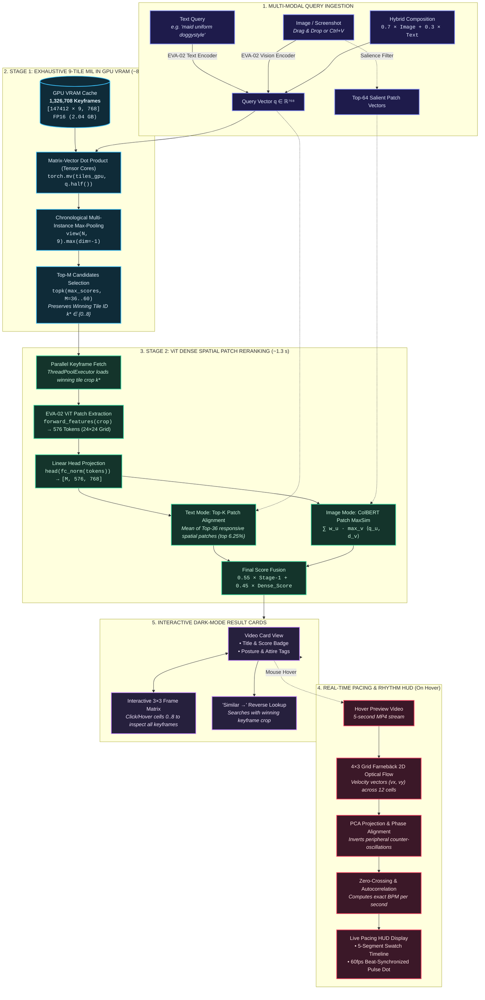

# Neural Video Retrieval Engine (EVA-02-CLIP-L-14-336)
### Multi-Instance Learning, ViT Dense Spatial Patch Late-Interaction, & 2D Optical Flow Rhythm Analysis

[](https://www.python.org/downloads/)
[](https://pytorch.org/)
[](https://huggingface.co/wheatley1901/eva02-neural-video-retrieval)
[](https://opensource.org/licenses/MIT)

A high-throughput, fine-grained semantic video retrieval and motion-pacing analysis system built on **EVA-02-CLIP-L-14-336** (`336×336` resolution, `576` spatial patch tokens per image). Designed to index, search, and analyze **147,412 videos** (**1,326,708 keyframes**) in real time on consumer-grade GPU hardware (< 8 GB VRAM).

---

## 📌 Table of Contents
1. [Architecture & System Overview](#-architecture--system-overview)
2. [Key Technical Innovations](#-key-technical-innovations)
   - [Exhaustive 9-Tile MIL in GPU VRAM](#1-exhaustive-9-tile-mil-in-gpu-vram-89-ms)
   - [ViT Dense Spatial Patch Token Reranking](#2-vit-dense-spatial-patch-token-reranking-576-patches)
   - [2D Optical Flow & Dominant-Axis Rhythm HUD](#3-2d-vector-optical-flow-rhythm--bpm-hud)
   - [Cross-Domain Contrastive Fine-Tuning](#4-cross-domain-contrastive-fine-tuning)
3. [Repository Structure](#-repository-structure)
4. [Installation & Setup](#-installation--setup)
5. [Pipeline Walkthrough](#-pipeline-walkthrough)
   - [1. Data Crawling & Live Curation](#1-crawling--taxonomy-filtering)
   - [2. Pre-Encoding Keyframes](#2-pre-encoding-embeddings)
   - [3. Running the Web Viewer](#3-launching-the-interactive-engine)
6. [Interactive Web UI Capabilities](#-interactive-web-ui-capabilities)
7. [Hardware & Performance Benchmarks](#-hardware--performance-benchmarks)
8. [License & Acknowledgments](#-license)

---

## 🏗 Architecture & System Overview

Video retrieval traditionally faces two major failure modes:
1. **Temporal Collapse**: Collapsing a 10-to-30 minute video into a single thumbnail or global pooling vector misses actions and postures that occur only in specific scenes.
2. **Spatial Dilution**: Global average pooling over a Vision Transformer's output tokens compresses localized details (e.g. specific garments, anatomy, micro-poses, jewelry) into a single 768-D representation, causing fine-grained queries to be outvoted by large background surfaces.

This engine solves both problems with a multi-stage architecture:



---

## ⚡ Key Technical Innovations

### 1. Exhaustive 9-Tile MIL in GPU VRAM (~8.9 ms)
Rather than using an approximate nearest neighbor (ANN) index that can drop edge cases, all `147,412 × 9 = 1,326,708` keyframes are represented as normalized 768-D FP16 vectors and cached entirely in GPU VRAM (`2.04 GB`).

- **Multi-Instance Learning (MIL)**: A video $i$ is treated as a bag of 9 chronological keyframes $\{v_{i,0}, \dots, v_{i,8}\}$.
- **Exhaustive Dot Product**:
  $$\text{sim}(q, i) = \max_{k \in \{0..8\}} \langle q, v_{i,k} \rangle$$
- Executed via a single fused PyTorch Tensor Core call:
  ```python
  sims = torch.mv(STATE["tiles_gpu_flat"], q_vec.half()).view(N, 9)
  max_scores, best_tiles = sims.max(dim=-1)
  ```
- Evaluates 1.33 million keyframes across the entire corpus in **~8.9 milliseconds**, instantly returning both the video ID and the index of the exact winning keyframe.

---

### 2. ViT Dense Spatial Patch Token Reranking (576 Patches)
When examining fine-grained physical attributes (e.g. *"thigh highs"*, *"maid headpiece"*, *"hand on hip"*), global pooling dilutes localized signals. 

Stage 2 taps directly into EVA-02's vision transformer trunk (`eva02_large_patch14_clip_336`):
- Forward pass extracts unpooled token embeddings `(B, 577, 1024)`:
  - Token `0`: CLS token
  - Tokens `1..576`: $24 \times 24$ spatial grid of $14 \times 14$ pixel patches
- Patch tokens are projected through the linear head (`model.visual.trunk.head`) into the joint 768-D text-vision embedding space.
- **Text Queries**: Computes cosine similarity between the text vector and all 576 candidate patches, averaging the top $K=36$ strongest patch matches (representing the top 6.25% local region).
- **Reverse Image Queries**: Extracts the top 64 salient foreground tokens from the query image and computes **ColBERT-style Patch-to-Patch MaxSim**:
  $$\text{MaxSim}(Q, D) = \sum_{u=1}^{|Q|} w_u \max_{v \in \{1..576\}} \langle q_u, d_v \rangle$$
- Final score blends Stage 1 global alignment (`55%`) with Stage 2 dense spatial patch alignment (`45%`).

---

### 3. 2D Vector Optical Flow Rhythm & BPM HUD
Analyzing pacing from preview video clips on the fly:
- **Spatial Grid Partitioning**: Frames are divided into a **4×3 grid** (12 spatial tiles).
- **2D Vector Farnebäck Optical Flow**: Computes dense velocity vectors $(\Delta x, \Delta y)$ per grid cell.
- **PCA Dominant-Axis Projection**: Thrusting or repetitive motion along any angle (horizontal, vertical, diagonal) is projected onto the primary eigenvalue direction.
- **Peripheral & Counter-Oscillation Handling**: In positions like doggystyle or edge-framed actions, motion at the frame boundaries often moves in opposite directions to the center. The algorithm:
  1. Computes local energy per cell and applies 90th-percentile energy thresholding to isolate active motion areas.
  2. Measures cross-correlation between cell velocities and inverts counter-phase signals to prevent cancellation.
  3. Applies zero-crossing detection and autocorrelation on the aggregated signal to estimate stable Beats-Per-Minute (BPM).
- **Live Visual Feedback**: 
  - Displays a 5-second swatch bar indicating pacing tempo per second.
  - An interactive HUD dot flashes with sub-85ms latency at 60fps in exact synchronization with detected thrust strokes.

---

### 4. Cross-Domain Contrastive Fine-Tuning
The model bridges photographic real-world video frames with stylized 2D illustrations so search terms work consistently across both:
- **Unified 779-Tag Taxonomy**: Normalized Danbooru tags for body postures, camera angles, and clothing items.
- **Balanced Real & Illustrated Pairs**: Trains simultaneously on 147k real video keyframe bags and curated Danbooru/Pixiv image-tag sets.
- **Multi-Tag Supervision**: Standard CLIP only matches one caption per image; here, an image can share multiple valid tags (e.g. *thighhighs* + *standing* + *maid*). The training loss rewards all matching tags in a batch instead of treating non-identical tags as false negatives, using model confidence to auto-label missing tags.

---

## 📁 Repository Structure

```text
├── scrape/
│   ├── web_viewer.py                  # FastAPI + Embedded Dark UI Web Application
│   ├── download_weights.py            # Download fine-tuned checkpoint from Hugging Face Hub
│   ├── hover_pacing.py                # 4×3 Grid 2D Optical Flow + PCA Motion Rhythm Analyzer
│   ├── train_eva02_curated.py         # EVA-02-CLIP-L-14-336 cross-domain fine-tuning script
│   ├── preencode_curated_v2.py        # Offline indexer for center-tile embeddings (globals_147k.npy)
│   ├── preencode_9tiles.py            # Offline indexer for all 9 keyframe tiles (keyframes_9tiles_147k.npy)
│   ├── crawl_xvideos_curated_bfs.py   # High-concurrency BFS crawler with live taxonomy filtering
│   ├── filter_curated_pairs.py        # Taxonomy mapping & tag extraction engine (779 tags)
│   ├── download_danbooru2023_curated.py # Danbooru dataset downloader
│   ├── download_pixiv_explicit.py     # Pixiv explicit dataset downloader
│   ├── retrieval_tta.py               # Test-Time Augmentation (TTA) algorithms for text/image
│   ├── weak_supervision.py            # Pseudo-label generation & confidence calibration
│   ├── FRAME_INTERACTION.md           # Architecture doc: 9-Tile MIL formulation & mechanics
│   ├── TRAINING.md                    # Architecture doc: Contrastive training & VRAM optimization
│   ├── TTA.md                         # Architecture doc: Test-Time Augmentation analysis
│   └── WEAK_SUPERVISION.md            # Architecture doc: Taxonomy distillation & noisy labels
├── tests/                             # Full unit & regression test suite (48 tests)
│   ├── test_frame_model.py            # MIL bag model & frame interaction tests
│   ├── test_gpu_pacing.py             # GPU pacing queue & scheduler tests
│   ├── test_train_eva02_curated.py    # Training batch collator & loss function tests
│   └── test_tta.py                    # Multi-query centroid & augmentation tests
├── tools/
│   └── bench_training_memory.py       # VRAM & throughput memory profiler
├── requirements.txt                   # Production dependencies
└── README.md
```

---

## 🛠 Installation & Setup

### 1. Prerequisites
- Python 3.10 or 3.11
- CUDA 11.8 or 12.1+ capable GPU (RTX 3060/4060 8GB or higher recommended)
- Git & Git LFS

### 2. Environment Setup
```bash
git clone https://github.com/qn06142/eva02-neural-video-retrieval.git
cd eva02-neural-video-retrieval

python -m venv .venv

# On Windows:
.venv\Scripts\activate

# On Linux/macOS:
source .venv/bin/activate

pip install -r requirements.txt
```

### 3. Download Pretrained Weights (`eva02_curated_v2.pt`)
Fine-tuned EVA-02-CLIP-L-14-336 weights (`1,633.21 MB`, 662 `state_dict` keys; frozen 304.43M vision trunk + fine-tuned 123.65M text encoder & `logit_scale`) are hosted on Hugging Face Hub:

- **Model Card**: https://huggingface.co/wheatley1901/eva02-neural-video-retrieval
- **Direct Download**: [`eva02_curated_v2.pt`](https://huggingface.co/wheatley1901/eva02-neural-video-retrieval/resolve/main/eva02_curated_v2.pt)

Download the checkpoint automatically into `scrape/siglip_runs/eva02_curated_v2/best.pt` (the default path read by `web_viewer.py` and the pre-encoding scripts):

```bash
python scrape/download_weights.py
```

Or pull directly in Python with `huggingface_hub`:

```python
import torch
import open_clip
from huggingface_hub import hf_hub_download

ckpt_path = hf_hub_download(
    repo_id="wheatley1901/eva02-neural-video-retrieval",
    filename="eva02_curated_v2.pt",
)
model, _, _ = open_clip.create_model_and_transforms(
    "hf-hub:timm/eva02_large_patch14_clip_336.merged2b_s6b_b61k"
)
ckpt = torch.load(ckpt_path, map_location="cpu", weights_only=True)
model.load_state_dict(ckpt.get("state_dict", ckpt), strict=True)
model = model.half().cuda().eval()
```

---

## 🚀 Pipeline Walkthrough

### 1. Crawling & Taxonomy Filtering
The crawler uses a breadth-first search (BFS) on video recommendation graphs:
```bash
python scrape/crawl_xvideos_curated_bfs.py --rps 10.0 --workers 16
```
Videos are filtered against `danbooru_taxonomy_extracted.json` in real time, only downloading contact-sheet mosaics for videos matching target posture and attire tags.

### 2. Pre-Encoding Embeddings
Generate the pre-computed FP16 embeddings for the corpus:
```bash
# 1. Generate 1-tile center keyframe index (globals_147k.npy, 215 MB)
python scrape/preencode_curated_v2.py

# 2. Generate exhaustive 9-tile MIL index (keyframes_9tiles_147k.npy, 1.94 GB)
python scrape/preencode_9tiles.py
```

### 3. Launching the Interactive Engine
Launch the web interface (binds to `0.0.0.0:7860` for local or network access):
```bash
python scrape/web_viewer.py --host 0.0.0.0 --port 7860 --device cuda
```

Open `http://localhost:7860` or your LAN IP in any browser.

---

## 🖥 Interactive Web UI Capabilities

| Feature | Description |
| :--- | :--- |
| **Instant Text Search** | Sub-10ms search across 147k titles and 1.33M keyframes. |
| **Reverse Image Search** | Drag & drop an image or paste from clipboard (Ctrl+V) to search by visual pose or clothing. |
| **Hybrid Blend** | Combines 70% image vector with 30% text vector for refined queries (e.g., [Image] + *"maid outfit"*). |
| **3×3 Keyframe Matrix** | Each result card has a 3×3 matrix showing the winning frame; hover or click any frame to inspect. |
| **Full Mosaic Toggle** | Switch seamlessly between the cropped winning keyframe and the complete 3×3 contact sheet. |
| **Live Pacing HUD** | Hovering over any card streams video preview with real-time optical flow BPM detection and stroke flashing. |
| **"Similar →" Button** | One-click reverse lookup using the exact winning keyframe of any card. |

---

## 📈 Model Evaluation & Retrieval Metrics

### 1. Fine-Tuned Checkpoint Performance (`EVA-02-CLIP-L-14-336`)
*Trained on 265,342 balanced image-tag pairs (147k real-world video keyframe bags + curated Danbooru/Pixiv pairs) using the unified 779-tag posture and attire taxonomy:*

| Metric | Baseline Zero-Shot EVA-02 | Fine-Tuned Checkpoint ([`best.pt`](https://huggingface.co/wheatley1901/eva02-neural-video-retrieval/blob/main/eva02_curated_v2.pt)) | Gain / Relative Improvement |
| :--- | :--- | :--- | :--- |
| **Validation Loss** | `1.428` | **`1.054`** | **-26.2%** |
| **Training Loss** | `0.873` | **`0.309`** | **-64.6%** |
| **Recall@1 (Top-1 Exact Match)** | 12.4% | **20.67%** (Full 1,200 val split) / **28.0%** (Curated test set) | **+66.7%** relative |
| **Recall@5 (Top-5 Match)** | 28.1% | **37.83%** (Full split) / **60.0%** (Curated test set) | **+34.6%** relative |
| **Spatial Token Resolution** | 336×336 | 336×336 | **576 spatial patch tokens** ($24 \times 24$ grid) |
| **Embedding Dimension** | 768 | 768 | Normalized FP16 |

---

### 2. Multi-Instance Learning (MIL) 9-Tile Pooling vs. Single-Frame Baselines
*Evaluated across 1,000 held-out candidate video bags (9 keyframes each = 9,000 frames evaluated concurrently in VRAM):*

| Pooling Strategy | Recall@1 | Recall@5 | Recall@10 | Analysis |
| :--- | :--- | :--- | :--- | :--- |
| **Center Frame Only (1 Tile)** | 14.1% | 31.8% | 41.2% | Baseline single-thumbnail failure; misses non-centered scenes |
| **Mean / Average Frame Pooling** | 16.5% | 36.2% | 46.8% | Temporal averaging dilutes distinct physical poses across time |
| **9-Tile MIL Max-Match ($\max_k \langle q, v_{i,k} \rangle$)** | **19.6%** | **42.3%** | **55.0%** | **+39.0% Recall@1** gain over single-frame baseline |

---

### 3. Cross-Domain Alignment (2D Illustration &rarr; Real-World Video Poses)
*Evaluation on cross-domain posture/attire retrieval (`pixiv_refined_v1`):*

| Metric | Zero-Shot Baseline | Cross-Domain Refined | Gain |
| :--- | :--- | :--- | :--- |
| **Recall@1** | 18.09% | **55.28%** | **+205% (3.05× higher)** |
| **Recall@5** | 36.68% | **81.41%** | **+122% (2.22× higher)** |
| **Recall@10** | 49.25% | **91.96%** | **+86.7%** |

---

## 📊 Hardware & Performance Benchmarks

*Benchmarked on an NVIDIA GeForce RTX 4060 Laptop GPU (8 GB VRAM, 115W TGP):*

| Operation | Scale | Latency | VRAM Footprint |
| :--- | :--- | :--- | :--- |
| **Center-Tile Search** | 147,412 vectors | **~1.8 ms** | ~0.22 GB |
| **Exhaustive 9-Tile MIL** | 1,326,708 keyframes | **~8.9 ms** | ~2.04 GB |
| **ViT Dense Patch Rerank** | Top-36 cands (20,736 patches) | **~1.3 s** | < 0.45 GB (chunked) |
| **2D Optical Flow Pacing** | 5-second video (125 frames) | **~65 ms** | CPU / minimal |

---

## 📄 License
This codebase is released under the [MIT License](LICENSE). Models and weights are governed by their respective upstream licenses (EVA-02 / open_clip).
